<picture>
  <source media="(prefers-color-scheme: dark)" srcset="https://github.com/user-attachments/assets/2f57377d-49b3-49cb-ab9d-6b85c1765f79" />
  <source media="(prefers-color-scheme: light)" srcset="https://github.com/user-attachments/assets/38f10d0d-5741-44dc-9263-e4a85609381d" />
  
</picture>

I'm a Computer Science student specialising in AI and machine learning. I like the space between a solid backend and an app that feels effortless, and lately that means running ML models directly on phones.

[Portfolio](https://shaury.me/) &nbsp;/&nbsp; [LinkedIn](https://linkedin.com/in/shaury-chaudhary) <!-- &nbsp;/&nbsp; [X](https://x.com/YOUR_HANDLE) -->

### Right now

- Putting on-device ML into mobile apps with TensorFlow Lite
- Learning Java, Spring Boot and Kafka for real-time backends
- Practising DSA, mostly dynamic programming
- Playing chess, which is where I learned to think a few moves ahead

### Things I've built

**Plant disease detector** — snap a leaf, get a diagnosis, fully offline.
`React Native` `TensorFlow Lite`

**Expense tracker** — scans receipts with OCR and syncs across devices in real time.
`React Native` `Firebase`

**Paper sorter** — reads academic papers and files them into categories automatically.
`Node.js` `React` `AI`

### Tools I use

### Activity

  <picture>
    <source media="(prefers-color-scheme: dark)" srcset="./profile/stats-dark.svg" />
    <source media="(prefers-color-scheme: light)" srcset="./profile/stats-light.svg" />
    
  </picture>
  <picture>
    <source media="(prefers-color-scheme: dark)" srcset="./profile/langs-dark.svg" />
    <source media="(prefers-color-scheme: light)" srcset="./profile/langs-light.svg" />
    
  </picture>

